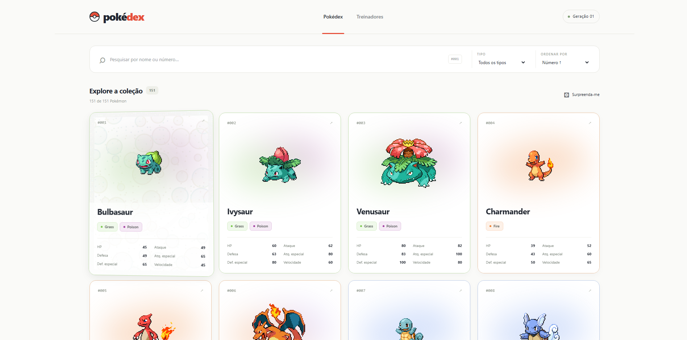
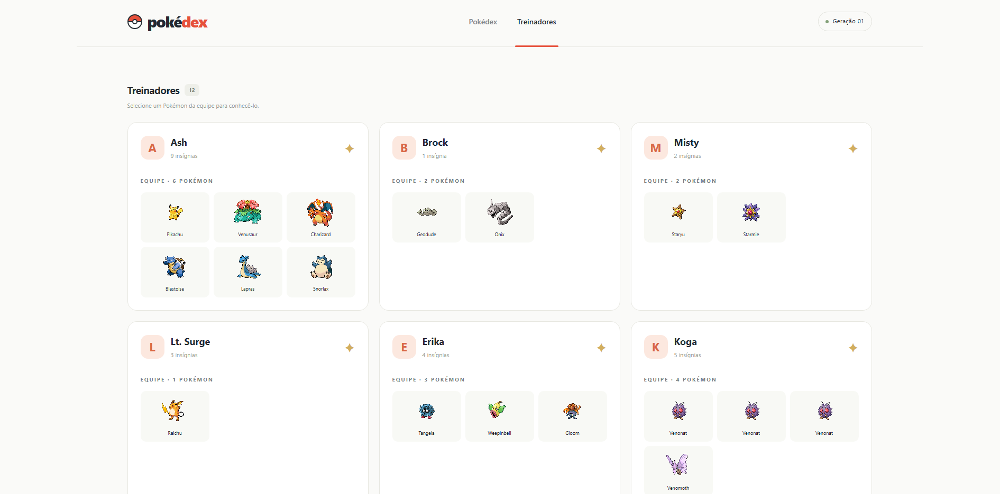

# Pokédex 

Atividade 03 de Desenvolvimento e Integração de Aplicações Web. Aplicação React + Vite para explorar os 151 Pokémon de Kanto e os 12 treinadores do arquivo fornecido na atividade.

## Executar

Requer Node.js 20.19+ da linha 20 ou Node.js 22.12+ e npm, conforme os requisitos do Vite instalado.

No terminal, entre na pasta da aplicação:

```powershell
cd pokedex
```

```bash
npm install
npm run dev
```

## Dados e imagens

**Fonte principal:** `src/data/pokedex-data.json`, fornecido pela atividade. Nomes, IDs, tipos, os seis atributos, treinadores, insígnias e relações vêm exclusivamente desse arquivo. A aplicação não precisa de banco de dados nem de uma resposta da API para pesquisar, filtrar ou consultar detalhes.

**Imagens:** sprites em pixel art da [PokéAPI](https://pokeapi.co/docs/v2#pokemon) e seu [repositório de sprites](https://github.com/PokeAPI/sprites). A coleção utiliza URLs de `sprites/pokemon/{id}.png`. Ao abrir os detalhes, uma consulta opcional a `https://pokeapi.co/api/v2/pokemon/{id}/` obtém `sprites.front_default`. Cards, detalhes e equipes usam `image-rendering: pixelated`. O efeito holográfico é uma camada independente; os sprites permanecem como imagens HTML nítidas.

As consultas aos detalhes ficam em cache na memória durante a sessão, inclusive requisições simultâneas, e têm limite de 10 segundos. Se a consulta falhar, a imagem padrão continua disponível. Se a imagem externa também falhar, é exibido `public/pokemon-placeholder.svg`; os dados e controles locais continuam funcionando. As imagens externas exigem conexão; a aplicação não é um PWA e não oferece instalação offline.

A paleta de cores é uma escolha visual do projeto em `src/data/pokemon-type-colors.js`; ela não é fornecida pela API. Os tipos utilizados para os filtros e cores são os do JSON da atividade, mesmo que uma classificação atual da API seja diferente.

## Organização

```text
src/
  components/
    HoloCard.jsx         # React Bits adaptado para conteúdo React e clique no modal
    HoloCard.css         # Estilos do efeito holográfico
    PokemonCard.jsx      # Card com atributos
    PokemonDetails.jsx   # Modal com detalhes e treinadores
    PokemonImage.jsx     # Imagem com alternativa local
    SearchBar.jsx        # Pesquisa, filtro e ordenação
    StatList.jsx         # Atributos compactos ou em barras
    TrainerList.jsx      # Treinadores e equipes
    TypeBadges.jsx       # Identificação visual dos tipos
  data/
    pokedex-data.json
    pokemon-type-colors.js
  services/pokeapi.js     # Consulta opcional e cache de imagens
  utils/pokemon.js        # Catálogo, pesquisa e ordenação
  App.jsx                # Estados, navegação e paginação
  App.css                # Interface e responsividade
  index.css              # Estilos globais e Tailwind
  main.jsx               # Entrada React com StrictMode
public/                  # Ícone e imagem alternativa locais
docs/screenshots/        # Capturas da aplicação
```

## Capturas da aplicação

### Pokédex

Busca, filtros e cards com sprites em pixel art, cores por tipo e efeito holográfico.



### Treinadores

Lista de treinadores com suas insígnias e equipes de Pokémon.


